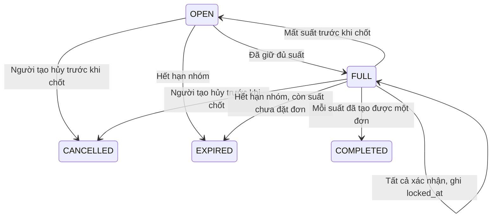
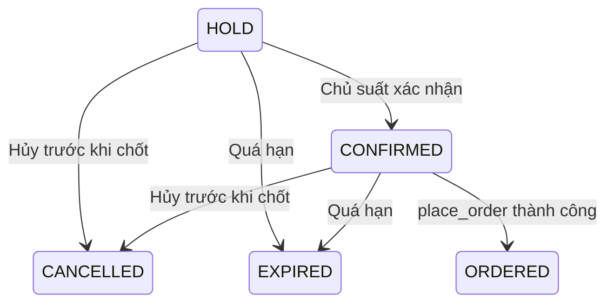
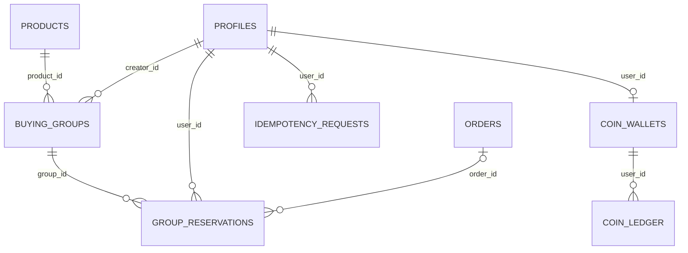

# WeBuy · API mua chung cho bản demo

Frontend tĩnh gọi Supabase Auth và RPC qua `WeBuyAPI`. PostgreSQL quản lý nhóm, suất, tồn kho và đơn. Người mua xem nhóm trên sản phẩm đang bán. Người đã đăng nhập có thể tạo hoặc tham gia nhóm. Chỉ chủ suất xem chi tiết suất. Chỉ người tạo hủy cả nhóm trước khi chốt. Cửa hàng được xác định theo sản phẩm trong catalog.

## Vòng đời nhóm và suất





- Mỗi cặp sản phẩm và mã khu vực có tối đa một nhóm `OPEN` hoặc `FULL`. `all` là mã Toàn quốc, cùng quy tắc với các mã khác. Nhóm dùng `products.min_members` tại lúc tạo, có thời lượng 1, 6, 12, 24, 48, 72 hoặc 168 giờ. Suất của người tạo được ghi trong cùng transaction.
- Một tài khoản có tối đa một suất hoạt động mỗi nhóm, mỗi suất mua một đơn vị. Trước khi chốt, suất `HOLD` hoặc `CONFIRMED` có hạn tối đa 10 phút tính theo DB, giới hạn bởi hạn nhóm. Tham gia lại sau khi hủy/hết hạn tạo một ID suất mới.
- `FULL` có nghĩa đã chiếm đủ chỗ. Khi đủ suất hợp lệ và tất cả đã xác nhận, DB ghi `locked_at`. Các suất xác nhận được đặt đơn đến `ends_at` và không còn chịu hạn giữ suất ban đầu. Chủ suất và người tạo chỉ hủy suất/nhóm trước khi chốt. Sau khi chốt, hủy đơn theo API của Nhi.
- Khi nhóm hết hạn, suất chưa đặt đơn mất hiệu lực. Đơn đã tạo đi theo vòng đời của Nhi; việc hết hạn nhóm không kích hoạt hủy đơn, hoàn tiền hoặc hoàn Xu. `COMPLETED` ghi nhận mọi suất đã tạo đơn, kể cả khi các đơn còn `PENDING`.
- RPC nhóm chỉ giữ suất. Hàng được giữ bên trong `place_order`. Nếu `take_stock` trả `OUT_OF_STOCK`, toàn bộ thao tác đặt đơn rollback, gồm đơn, dòng đơn, kho và suất. Một suất có giá riêng được lưu bằng `price_for(product_id, 'group')` lúc giữ suất. Giá đó áp dụng cho giỏ, checkout, `order_items.unit_price`, thành tiền và tổng đơn.

## Request và response

Gọi `POST /rest/v1/rpc/<tên RPC>`. Mọi thao tác ghi của người dùng cần JWT Supabase. `create_buying_group` và `join_buying_group` cần khóa UUID. SDK browser gửi `p_request_key` trong JSON; PostgREST cũng nhận header `Idempotency-Key`. Nếu gửi cả hai, chúng phải trùng. Giữ nguyên khóa và payload khi chưa nhận được kết quả. Cùng người dùng, thao tác và khóa nhận lại status/body đã lưu; cùng khóa khác payload trả `409 IDEMPOTENCY_KEY_REUSED`. Snapshot phát lại mô tả thời điểm xử lý ban đầu, nên UI polling lấy trạng thái hiện tại.

| RPC | JSON đầu vào | HTTP và kết quả |
| --- | --- | --- |
| `health` | `{}` | Công khai, `200 {status: "ok"}` |
| `list_buying_groups` | `{p_product_id, p_region_code?}` | Công khai trên sản phẩm đang bán, `200 {items, serverNow}`. Mỗi phần tử là một snapshot, tối đa 50. Thành viên cũng thấy lịch sử nhóm của mình. |
| `get_buying_group` | `{p_group_id}` | Công khai trên sản phẩm đang bán, `200` snapshot. |
| `create_buying_group` | `{p_product_id, p_region_code, p_duration_hours, p_request_key?}` | `201` snapshot có suất của người tạo. Thời lượng là số JSON thuộc danh sách giờ hợp lệ. Chuỗi, kiểu khác và số ngoài danh sách trả `400 INVALID_DURATION`. |
| `join_buying_group` | `{p_group_id, p_request_key?}` | `201` khi giữ suất mới, `200` khi người gọi đã có suất hoạt động. |
| `confirm_group_reservation` | `{p_reservation_id}` | Chủ suất. `200` snapshot. Lần xác nhận cuối cùng chốt nhóm. |
| `cancel_group_reservation` | `{p_reservation_id}` | Chủ suất trước khi chốt. `200` snapshot. Hủy lại suất đã hủy giữ nguyên số chỗ. |
| `cancel_buying_group` | `{p_group_id}` | Người tạo trước khi chốt. `200` snapshot có trạng thái `CANCELLED`. |
| `expire_buying_groups` | `{p_limit?}` | Tác vụ backend, `200 {expiredGroups, expiredReservations}`. Gọi lại an toàn. |
| `add_to_cart` | `{p_product_id, p_kind: "group", p_quantity: 1, p_group_ref}` | Chủ suất đã chốt. `200` giỏ có một dòng theo nhóm, giá theo suất. |
| `place_order` | `{p_cart_item_ids, p_shipping, p_client_request_id}` | Chủ giỏ. `200` đối tượng đơn có `id`. Cùng request ID và nội dung trả lại đơn đã tạo, kể cả khi giỏ đã được dọn. Đổi nội dung với cùng ID trả `409 IDEMPOTENCY_KEY_REUSED`. |

`place_order` so sánh tập ID dòng giỏ đã sắp xếp, bỏ ID lặp, cùng tên và địa chỉ đã bỏ khoảng trắng ở hai đầu, số điện thoại đã bỏ khoảng trắng, dấu chấm và dấu gạch nối. Đơn cũ thiếu tập ID vẫn replay khi thông tin nhận hàng khớp, vì các ID dòng giỏ ban đầu không còn để đối chiếu. Checkout giữ key và nội dung trong phiên trang khi kết quả chưa rõ, khóa các trường nhận hàng đã gửi để người dùng thử lại cùng nội dung.

Ví dụ response tham gia thành công:

```json
{
  "group": {
    "id": "d9e9b57f-32d9-4b29-a767-88f52daa9912",
    "productId": "2",
    "regionCode": "hn",
    "status": "FULL",
    "capacity": 5,
    "occupied": 5,
    "confirmedCount": 3,
    "lockedAt": null,
    "endsAt": "2026-11-29T16:00:00Z",
    "canCancel": false
  },
  "myReservation": {
    "id": "e70325be-45b8-4abf-ab1a-b668668d0450",
    "status": "HOLD",
    "unitPriceSnapshot": 149000,
    "expiresAt": "2026-11-29T15:10:00Z",
    "orderId": null
  },
  "serverNow": "2026-11-29T15:00:00Z"
}
```

Khách hoặc tài khoản chưa có suất nhận `myReservation: null`. Giờ API dùng ISO 8601 có múi giờ. Ví dụ lỗi `409`: `{"code":"PT409","message":"FULL","details":"Nhóm đã đầy.","hint":null}`.

| HTTP | Ví dụ mã nghiệp vụ |
| --- | --- |
| 400 | `INVALID_REGION`, `INVALID_DURATION`, `IDEMPOTENCY_KEY_REQUIRED`, `INVALID_IDEMPOTENCY_KEY`, `GROUP_REQUIRED`, `INVALID_GROUP_QUANTITY` |
| 401 | Phiên thiếu/hết hạn, hoặc `AUTH_REQUIRED` |
| 403 | `NOT_GROUP_CREATOR`, `RESERVATION_REQUIRED` |
| 404 | `PRODUCT_NOT_FOUND`, `GROUP_NOT_FOUND`, `RESERVATION_NOT_FOUND` |
| 409 | `GROUP_ALREADY_OPEN`, `FULL`, `GROUP_EXPIRED`, `GROUP_CLOSED`, `GROUP_NOT_READY`, `GROUP_NOT_CANCELLABLE`, `RESERVATION_EXPIRED`, `RESERVATION_NOT_EDITABLE`, `RESERVATION_ALREADY_ORDERED`, `IDEMPOTENCY_KEY_REUSED`, `OUT_OF_STOCK` |

## Dữ liệu và đồng bộ



RPC khóa dòng nhóm trước khi đổi suất. Checkout khóa các nhóm theo ID, kiểm lại nhóm đúng sản phẩm, đã chốt, còn hạn và suất của người gọi đã xác nhận, chưa dùng. Phía browser đọc tóm tắt qua RPC, chi tiết suất qua RLS chủ suất, ví và ledger qua RLS chủ ví. Bảng khóa yêu cầu dùng nội bộ. Ví và ledger chỉ có schema.

Trang chi tiết polling mỗi 2 giây khi hiển thị và tải mới ngay sau thao tác, khi quay lại tab hoặc có mạng. Hạn hiển thị dựa vào `serverNow`; RPC đọc tính trạng thái hiệu lực ngay khi đến hạn. RPC ghi và tác vụ dọn cập nhật trạng thái lưu trong DB. `notify` gửi cho người giữ suất khi chốt nhóm, hủy nhóm hoặc hết hạn suất. Để ghi trạng thái hết hạn và gửi thông báo ngay cả lúc không có request ghi, staging có thể lên lịch tác vụ dọn.

Nguồn SQL: [schema](../webuy-backend-nhi/supabase/migrations/20261129001000_hoa_group_schema.sql), [RPC nhóm](../webuy-backend-nhi/supabase/migrations/20261129001100_hoa_group_rpcs.sql), [giỏ và đặt đơn](../webuy-backend-nhi/supabase/migrations/20261129001200_hoa_group_checkout.sql).
